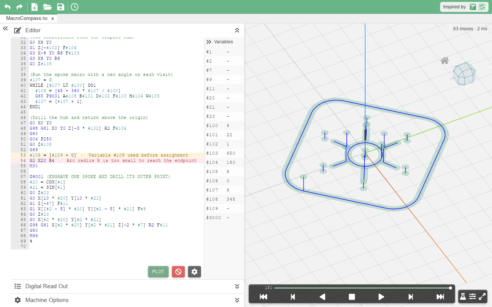

# CNC Viewer

[NC Viewer](https://ncviewer.com/) from [Toolpath Labs, Inc.](https://toolpath.com/) is the inspiration for the 3D backplot, syntax highlighting, icon style, colours, and general layout. I built this Windows desktop app in Rust for my [MachPro](https://www.mach-labs.com/product/machpro/) router and to give AI agents a way to verify the G-code they write.

## Features

- Interactive 3D backplot.
- Cutter trails that show the width of a configured bit.
- FANUC-style Macro B variables, expressions, loops, branches, and subprograms.
- Execution slider that follows repeated blocks.
- Variable viewer that updates as execution progresses.
- Feed-timed playback defaults to 8× estimated machining speed.
- Inline G-code errors and warnings.
- Background replotting after edits.
- Tabbed editor with split views.
- Disk sync with overwrite protection.
- An agent CLI for XYZ movement reports, projected cutter overlaps, stock sections, and labelled PNG views.

## Get started

Download `CNC-Viewer-windows-x64.exe` from [Releases](https://github.com/heetbeet/CNCViewer/releases), or build locally with `./tools/build.ps1` using Rust MSVC and the Windows SDK.

The executable includes the complete agent guide.

```powershell
& './CNC-Viewer-windows-x64.exe' --help agents | Out-String
```

Contributions are welcome, especially for items in [Next work](#next-work). [Icon artwork credits](crates/cnc-app/assets/NOTICE.md).

## Next work

- Linux and macOS support.
- Selectable machine config files with custom G- and M-code mappings.
- Lua macros and additional G-code dialects.
- Per-tool cutter diameter editing and cutter-radius compensation (G41/G42) in the backplot.
